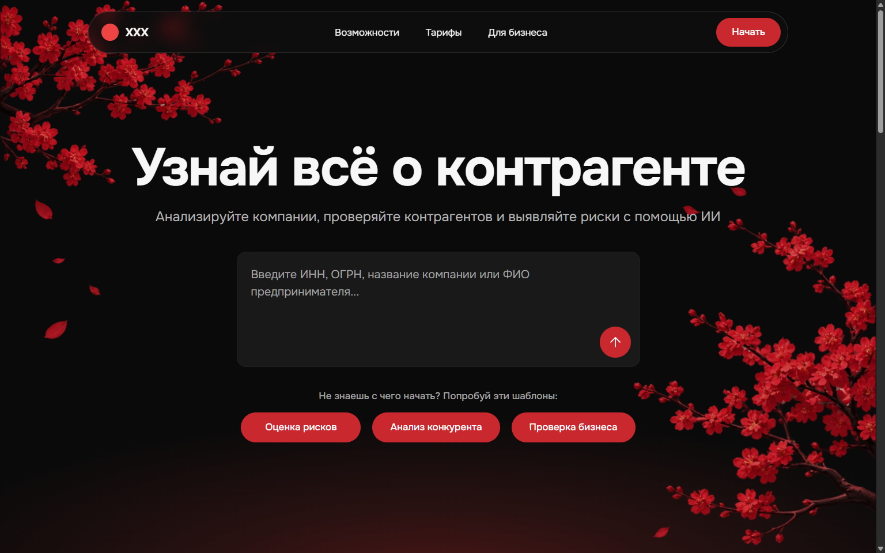
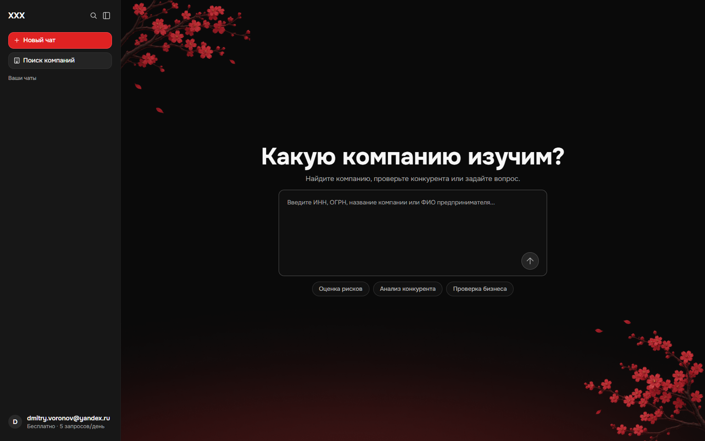
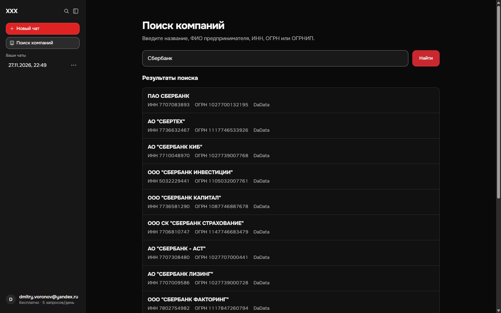
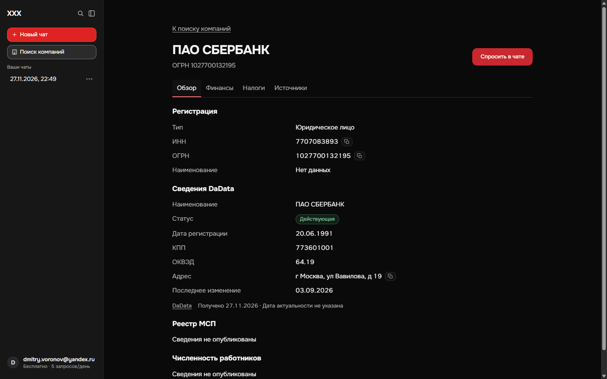

# ScanINN — сервис поиска и ИИ-анализа российских компаний

Веб-сервис для поиска, проверки контрагентов и ИИ-анализа российских юридических лиц и индивидуальных предпринимателей по официальным данным ФНС и DaData.

## Основные возможности

- **Поиск компаний и ИП** по ИНН, ОГРН/ОГРНИП, названию или ФИО предпринимателя (локальная база ФНС + DaData).
- **Карточка компании** с разделением по источникам и датам актуальности:
  - регистрационные реквизиты (DaData, ЕГРЮЛ/ЕГРИП);
  - реестр МСП;
  - доходы и расходы;
  - среднесписочная численность работников;
  - уплаченные налоги, задолженности и специальные налоговые режимы.
- **ИИ-чат для анализа бизнеса**: диалоги с историей, примерами запросов, экспортом ответов и контролем дневных квот.
- **Аккаунты и безопасность**: регистрация, вход по Bearer-сессии, настройки профиля, управление историей диалогов, rate limiting на API.

---

## Интерфейс

### Лендинг



### ИИ-чат



### Поиск компаний



### Карточка компании



---

## Стек

- **Backend:** Go + Gin, PostgreSQL, встроенные SQL-миграции (`backend/migrations`).
- **Frontend:** Next.js 16 (App Router), React 19, TypeScript, Tailwind CSS 4, `openapi-fetch`.
- **Источники данных:** открытые наборы ФНС (МСП, доходы/расходы, численность, налоги, спецрежимы) + DaData API.

---

## Структура репозитория

```text
company-search/
├── backend/          # Go API, миграции, импортеры ФНС, CLI-инструменты
├── frontend/         # Next.js веб-интерфейс
├── docs/             # Документация и скриншоты
├── design/           # Дизайн-референсы и токены
├── BRIEF.md          # Контекст и требования проекта
├── TODO.md           # План реализации
└── PROGRESS.md       # Статус разработки
```

---

## Быстрый старт

### 1. Запуск бэкенда и PostgreSQL

Из каталога `backend/` (PowerShell):

```powershell
$env:POSTGRES_PASSWORD = [guid]::NewGuid().ToString('N')
$env:DATABASE_URL = "postgres://company_search:${env:POSTGRES_PASSWORD}@127.0.0.1:5432/company_search?sslmode=disable"
docker compose up -d --wait
go run ./cmd/migrate
go run ./cmd/api
```

По умолчанию API запускается на `:8080`. Проверка готовности:

```powershell
curl.exe -i http://localhost:8080/healthz
curl.exe -i http://localhost:8080/readyz
```

Подробнее о переменных окружения, импорте наборов ФНС (`cmd/import`) и настройке DaData / Resend см. в [backend/README.md](backend/README.md).

### 2. Запуск фронтенда

Из каталога `frontend/`:

```powershell
npm install
npm run dev
```

По умолчанию Next.js dev-сервер запускается на `http://localhost:3000` (или следующем свободном порту, если 3000 занят).

---

## Тесты и проверка

### Backend

```powershell
cd backend
go test ./...
```

### Frontend

```powershell
cd frontend
npm run lint
npm test
npm run build
```
